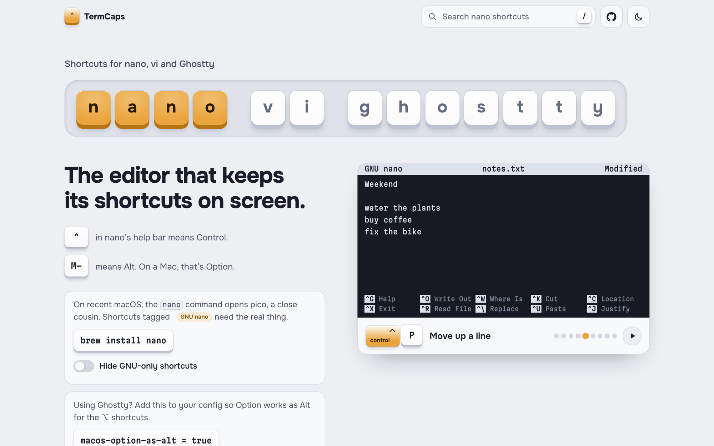

# TermCaps

Shortcuts for nano, vi and Ghostty, drawn as keycaps you can see.

**[termcaps.com](https://termcaps.com)**

<picture>
  <source media="(prefers-color-scheme: dark)" srcset="docs/screenshot-dark.png">
  
</picture>

## What's inside

- **195 shortcuts** for nano, vi/Vim and Ghostty, each drawn as real keycaps (`⌃ control`, `⌘ command`)
- **An animated demo for each tool** that plays the essential moves and shows which keys are pressed
- **Search** with <kbd>/</kbd>, and switch tools with <kbd>1</kbd> <kbd>2</kbd> <kbd>3</kbd>
- **Hold <kbd>⌃</kbd> <kbd>⌥</kbd> <kbd>⌘</kbd> or <kbd>⇧</kbd>** to light up every shortcut that uses it. Press the full combo to jump to that row.
- **Click any command or config line** to copy it
- Light and dark themes. Works on phones. Printing gives you all three sheets on paper.

## Run it locally

There's no build step and nothing to install.

```sh
git clone https://github.com/nitin7dc/termcaps.git
cd termcaps
open index.html
```

## Good to know

- **On recent macOS, `nano` is really pico.** Shortcuts tagged *GNU nano* need the real thing (`brew install nano`). The page has a switch to hide them.
- **Ghostty shortcuts are the macOS defaults in Ghostty 1.4.** Run `ghostty +list-keybinds` to see your own.
- vi on macOS opens Vim, so everything in the vi sheet works there.

## Add or fix a shortcut

Every shortcut lives in [`data.js`](data.js). A row looks like this:

```js
{ k: 'ctrl+o', d: 'Save', n: 'Asks for a file name.' }
```

| Field | Meaning |
| --- | --- |
| `k` | The keys (format below) |
| `c` | Text to type or paste, such as a config line or shell command. It shows as a copy button. |
| `d` | What it does, in plain words |
| `n` | Optional note |
| `gnu` | nano only: not available in the macOS pico |

Key format for `k`:

| You write | You get |
| --- | --- |
| `ctrl+o` | One combo. Modifiers are `ctrl`, `alt`, `cmd` and `shift`. |
| `ctrl+w w` | A sequence: ctrl+w, then w |
| `d d` | Two separate presses |
| `w / b` | A pair, matching a description like "Next / previous word" |
| `f {char}` | `{name}` is a placeholder |
| `:wq`, `/{text}` | Anything starting with `:` `/` or `?` is a command |
| `['a', 'b']` | Alternatives, shown with "or" |

Named keys: `esc`, `enter`, `tab`, `bksp`, `space`, `left`, `right`, `up`, `down`, `arrows`, `home`, `end`, `pgup`, `pgdn`.

Pull requests are welcome. Please check new shortcuts against the real tool before adding them.

## Project layout

| File | What it does |
| --- | --- |
| `index.html` | Page shell |
| `styles.css` | Keycaps, layout, themes, print styles |
| `data.js` | All the shortcuts |
| `keys.js` | Turns key specs into keycaps |
| `demos.js` | The animated terminal demos |
| `app.js` | Tabs, search, modifier highlighting, copy, theme |

## License

[MIT](LICENSE) © Nitin Sharma ([nitin7dc](https://github.com/nitin7dc))
